  
  
  
  
  
  

 

I'm an AI/ML engineer with a full-stack background, which mostly means I don't stop at the model. For the past 2+ years I've built multi-agent systems, LLM orchestration and RAG pipelines, MCP servers, and the backends and frontends that put them in front of real users.

What I care about is the gap between "it works in a notebook" and "it works in production": making systems faster, cheaper, observable, and honest about what they don't know. The terminal above is roughly how I think about every system I build.

 

### Selected work

<!-- Most of this lives in private repos, so no links. -->

| Project | What it does | Built with |
|:--|:--|:--|
| **Multi-Agent Stock Market Orchestrator** | Specialist agents for fundamentals, technicals, sentiment, screening, and portfolios across Indian and global exchanges. Every answer is scored before it's shown, with a live web fallback when confidence is low. | LangGraph, FastAPI, Redis, RabbitMQ, Langfuse |
| **Autonomous Code Security Agent** | A multi-tenant CLI agent that audits codebases for vulnerabilities, writes and reviews code, ships fixes, and opens and reviews pull requests on its own, end to end. | CLI, multi-agent, LLMs, GitHub API |
| **Autonomous AI QA Agents** | Maps a product on its own, then tests it across web, API, and real Android devices. Keeps a memory of every bug and reopens regressions automatically. | Multi-agent, LLM triage, prompt caching |
| **Autonomous Data Analyst Agent** | A team of parallel analyst agents, coordinated by an editor agent, that turns raw business data into a publication-ready, charted report in under a minute. | LangGraph, Groq |
| **Deterministic-First Trading Assistant** | A Telegram bot where rule-based agents and a consensus engine make the call, the LLM only explains it, and a ledger grades its own past predictions. | Python, multi-agent, LLMs |
| **Secure MCP Data Gateway** | Gives AI assistants like Claude governed, plain-English access to production databases, with OAuth 2.0 auth and live use as a Claude.ai connector. | MCP, OAuth 2.0, PostgreSQL |

 

### Toolkit

**AI / ML** 
&nbsp;

**Languages** 

**Backend & Web** 

**Data** 
&nbsp;

**Infra & MLOps** 
&nbsp;

 

### Activity

  
  

  

 

  Open to AI/ML engineering roles and interesting problems. The fastest way to reach me is <a href="https://linkedin.com/in/faiz-khan77">LinkedIn</a>.

